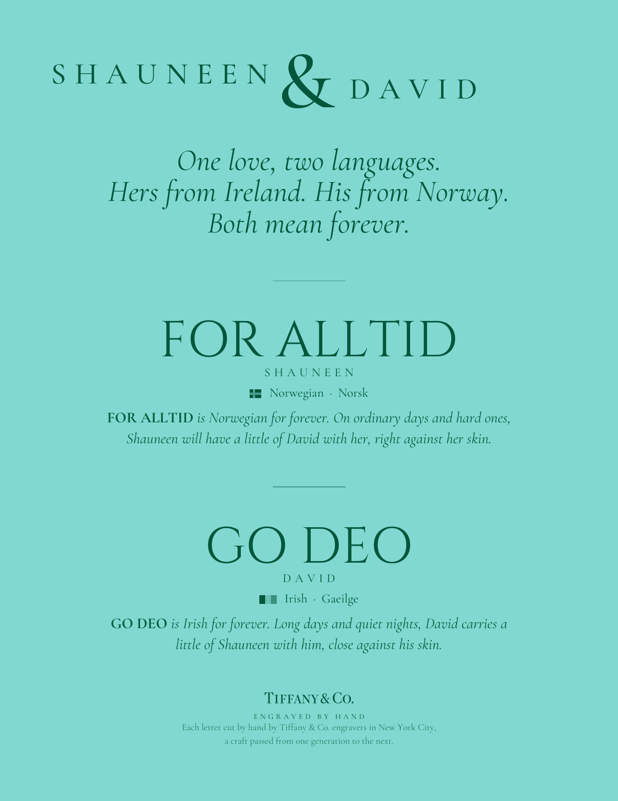

# FOR ALLTID · GO DEO

A one-page keepsake describing the inscriptions inside Shauneen and David's Tiffany & Co. wedding bands.

- **Shauneen's ring:** FOR ALLTID, Norwegian for forever.
- **David's ring:** GO DEO, Irish for forever.

Both are hand engraved in capitals by Tiffany & Co. engravers in New York City.



[Download the PDF](Wedding-Band-Inscriptions.pdf)

## Build it

The page is drawn with Python and ReportLab. Spacing is set from measured ink, not font boxes: every gap between visible marks inside a group is 11 pt, and the gaps between groups are calculated so the content fills a US Letter page between 54 pt margins.

Requirements: Python 3, npm, and `pdftoppm` (from poppler).

```sh
pip install -r requirements.txt
python3 setup_fonts.py    # downloads Cormorant Garamond and Cinzel into ./fonts
python3 make_pdf.py       # writes Wedding-Band-Inscriptions.pdf
```

## Type and color

- Text: Cormorant Garamond. Inscriptions: Cinzel, standing in for an engraver's Roman capital.
- Ink #00563B on Tiffany Blue #81D8D0.

Both fonts are under the SIL Open Font License. The Tiffany & Co. wordmark is a trademark of Tiffany & Co.
